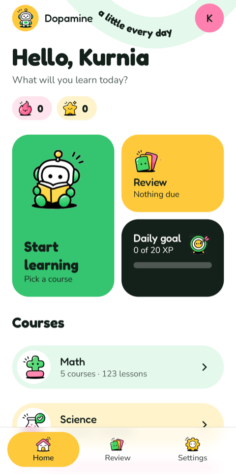
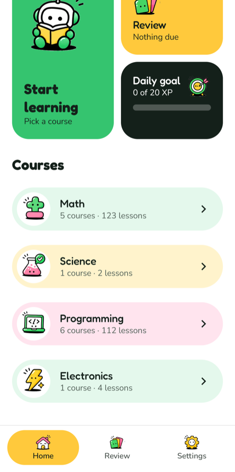
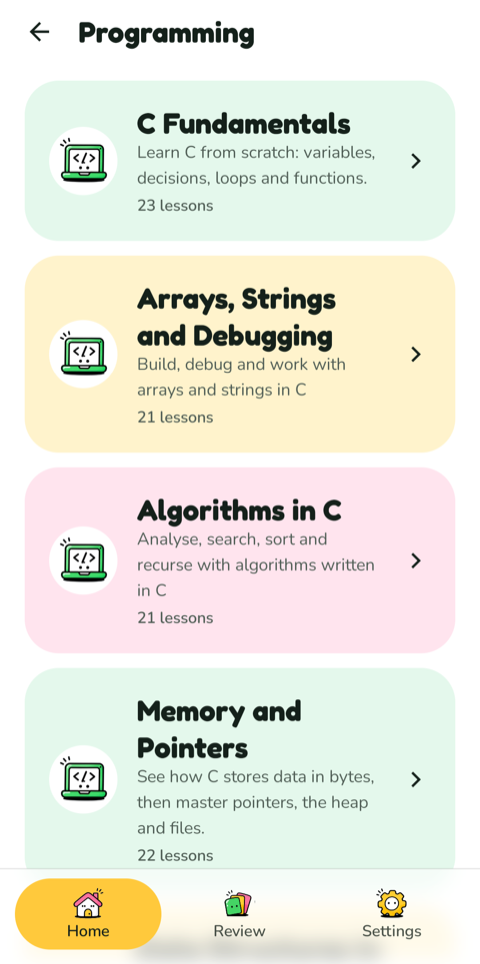
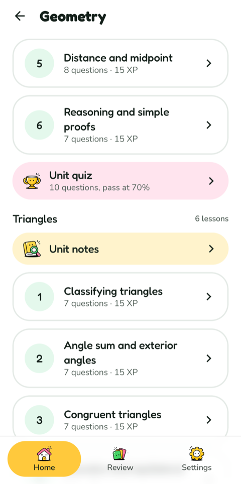
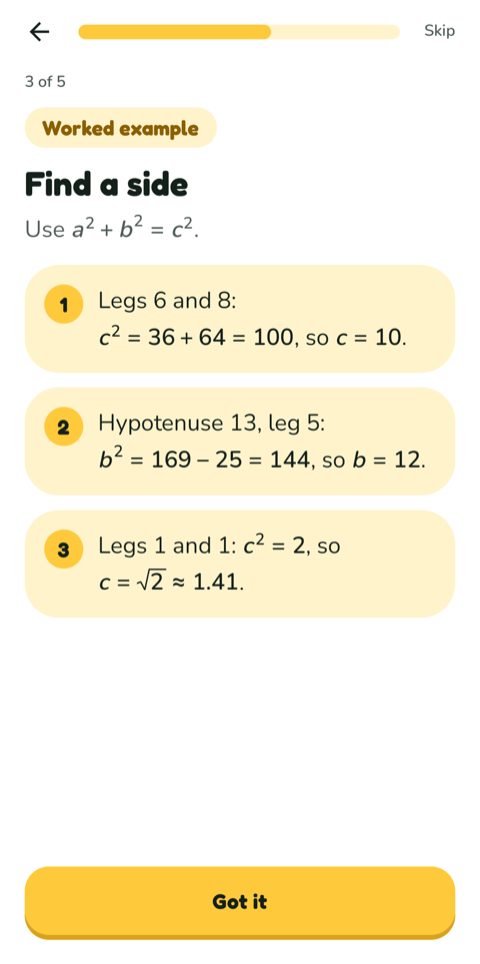
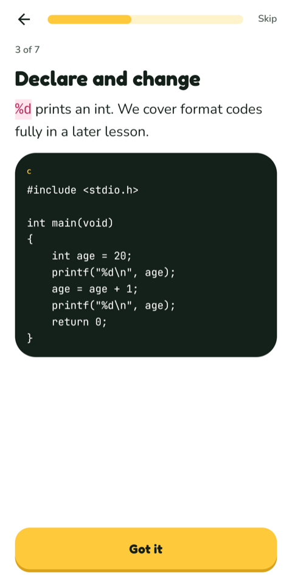
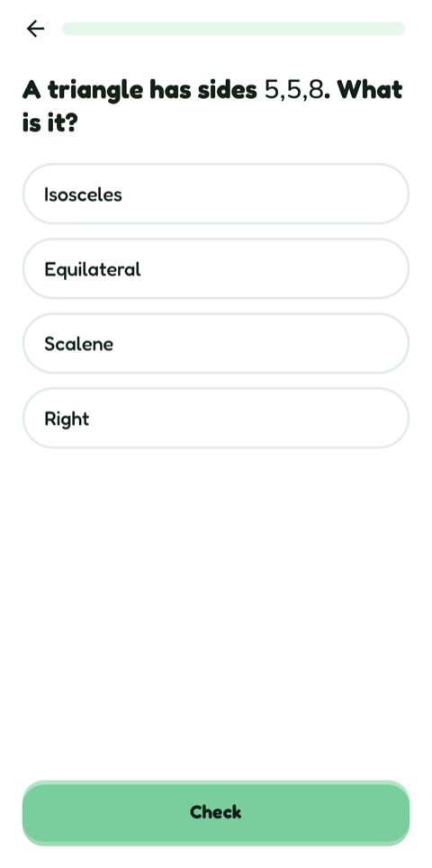
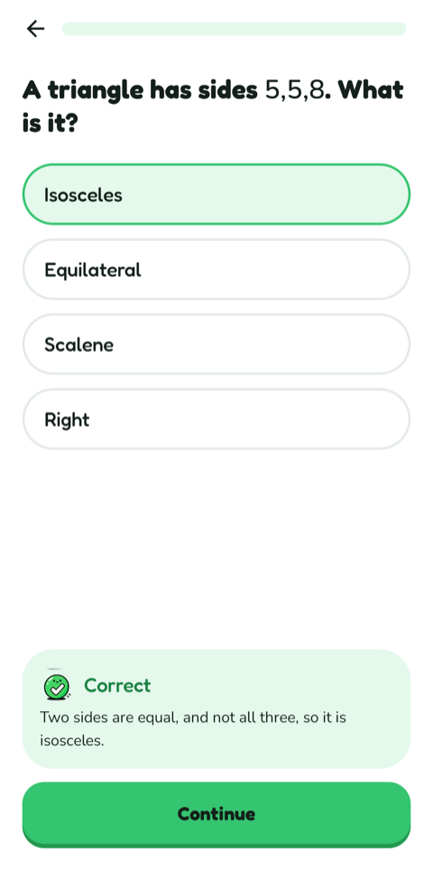
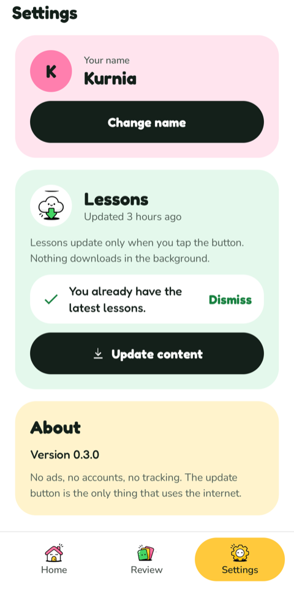

# Dopamine

Short, rewarding daily lessons on your phone, with **no ads, no accounts and no tracking**. Dopamine is a fully native Android app (Kotlin + Jetpack Compose) with 241 lessons in 13 courses: math from pre-algebra to precalculus, programming in C and Python, science and electronics.

<p align="center">
  
  
  
</p>

*Screenshots are from a real Redmi Note 10S.*

## What you get

- **Learn, then practice.** Each lesson is a few short reading pages (text, worked examples that reveal one step at a time, tips, code) followed by questions with an explanation for every answer.
- **Unit notes and unit quizzes.** A cheat sheet for each unit, and a 10-question quiz (pass at 70%) that mixes questions from the whole unit.
- **Real math and code.** Math is drawn natively from LaTeX, geometry lessons carry SVG diagrams, and C and Python code appear in proper code blocks.
- **XP, streaks and a daily goal**, saved on your phone.
- **Private by design.** No ads, no accounts, no analytics, no WebView. The only permission is `INTERNET`, used by one button.
- **Works offline.** Lessons are stored on the phone. Tap **Update content** when you want new ones; nothing downloads in the background.

<p align="center">
  
  
  
  
  
  
</p>

## Courses

| Subject | Courses | Lessons |
|---|---|---|
| Math | Pre-Algebra, Algebra 1, Geometry, Algebra 2, Precalculus | 123 |
| Programming | C Fundamentals, Arrays, Strings and Debugging, Algorithms in C, Memory and Pointers, Data Structures in C, Programming Basics (Python) | 112 |
| Science | Science Basics | 2 |
| Electronics | Electronics Basics | 4 |

Lessons live in a separate repository, [`Kmassidik/dopamine-content`](https://github.com/Kmassidik/dopamine-content), and arrive through the **Update content** button. The app is usable on first launch with bundled sample content.

> **Status: early but usable.** Not built yet: spaced review, hearts, a final course test and settings such as dark theme. See the roadmap in the content repo for what is planned next.

## Try it (Android only)

Download `dopamine-0.3.0.apk` from the [latest release](https://github.com/Kmassidik/dopamine/releases/latest), open it on an Android 7.0+ phone (allow "install unknown apps" if asked), then open **Settings, Update content** once to download the lessons. There is no iPhone or web version.

<p align="center">
  
</p>

## Documents

| File | Read it for |
|---|---|
| [`CONTRIBUTING.md`](CONTRIBUTING.md) | How to build, test and send a change |
| [`DESIGN.md`](DESIGN.md) | Colors, type, shapes, motion, components |
| [`TESTING.md`](TESTING.md) | Test commands, the design guard (screenshot tests) and the manual checklist |

## Build and run

You need a JDK 21+ with `javac` (this project is built on JDK 25) and the Android SDK (platform 37, build-tools 35+).

```bash
./build.sh                    # unit tests + lint + debug and release APKs
./build.sh assembleDebug      # or any Gradle tasks
```

APKs land in `app/build/outputs/apk/{debug,release}/`. The release APK is signed with the debug key so it installs for personal use; use a real keystore before sharing it.

Install on a phone:

```bash
adb install -r app/build/outputs/apk/debug/app-debug.apk
adb shell am start -n app.dopamine/.MainActivity
```

On Xiaomi/MIUI, turn on *Developer options → Install via USB* and *USB debugging (Security settings)*, and tap Install on the phone promptly.

## How it works

```
 first launch        Update content (Settings)                 lessons, notes and practice
      |                         |                                          ^
 assets/content  ->  filesDir/content  <-- swap <-- stage <-- verified downloads
 (bundled seed)       (what the app reads)                  (https, sha256, size, schema, path checks)
```

- The app only ever reads `filesDir/content`. On first launch (or if that folder is missing or corrupt) it is seeded from `app/src/main/assets/content`, a small sample (six lessons) in the same layout as the content repo: `manifest.json` at the top and everything else under `content/`.
- **Update** fetches `manifest.json` from the content repo (`BuildConfig.CONTENT_BASE_URL`), diffs lessons by id/version/sha256 (and re-fetches any file missing on the phone, for example after a file moved), downloads only what changed into a staged copy, verifies every file, deletes files the new manifest no longer references, and then swaps the staged folder in atomically. Any failure discards the stage and leaves current content untouched.
- Your name is stored on the phone in a Room (SQLite) database and used for the greeting.

## Repositories

- **App:** this repository.
- **Content:** [`dopamine-content`](https://github.com/Kmassidik/dopamine-content). Lesson JSON, SVG diagrams, JSON Schemas, and the manifest generator. To publish new lessons: edit files, run `python3 tools/build_manifest.py`, push to `main`, and tap Update in the app.

Manifest paths are relative to the content repo root and start with `content/` (for example `content/math/geometry/triangles/lesson-01.json`), because the app downloads `base URL + path`. To refresh the bundled sample from a checkout of the content repo:

```bash
python3 tools/sync_seed.py ../dopamine-content
```

## Licenses

Fredoka and Nunito (SIL OFL 1.1, `licenses/Fredoka-OFL.txt`, `licenses/Nunito-OFL.txt`). Icons are generated by the owner. Libraries: AndroidX, Jetpack Compose, Room, Kotlin, kotlinx.serialization, kotlinx.coroutines (Apache 2.0); OkHttp (Apache 2.0).
